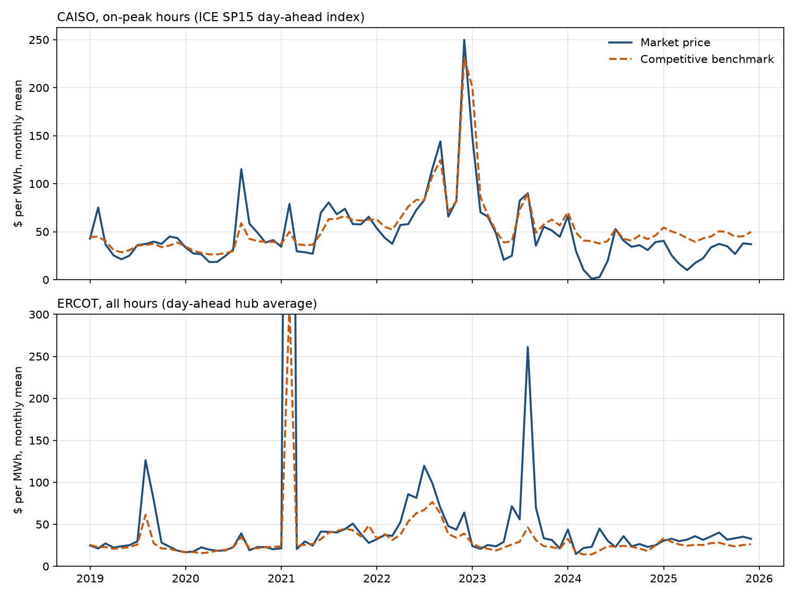
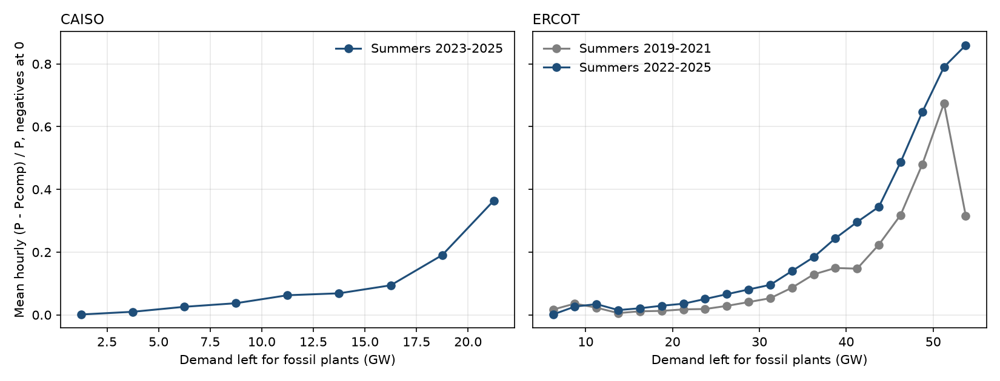

# The Competitive Benchmark

### In 2002, Severin Borenstein, James Bushnell and Frank Wolak measured how far California's wholesale electricity prices ran above competitive levels in the 2000 crisis. I rebuilt their benchmark for California and Texas, 2019 to 2025.

---

In August 2024 the High Desert Power Plant, a gas-fired combined-cycle station in Victorville operated by MRP Generation
Holdings, could turn a million British thermal units of natural gas into about 135 kilowatt-hours of electricity. Gas
delivered to California power plants cost $3.18 per million Btu that month, and every ton of carbon dioxide it emitted
needed a state allowance that had sold at auction for $30.24. Add a few dollars for wear and tear and a megawatt-hour
from High Desert cost about $38 to make. That same month the California Independent System Operator's day-ahead
market paid an average of $40.22 for each megawatt-hour of energy.

In August 2000 the California Power Exchange, the market's predecessor, paid $166.24 a megawatt-hour on average while the cost of the last plant needed to keep the lights on was
about $76. One of the state's utilities went bankrupt as the bills came due, and three economists at Berkeley and
Stanford built the method used to measure who had taken the difference.

---

## What a competitive price would be

A wholesale electricity market runs a new auction every hour. If every generator offered its power at the cost of
producing one more megawatt-hour, the auction would line plants up from cheapest to dearest and the price would be the
cost of the last plant needed to meet demand. That cost is the competitive benchmark. For a gas plant it is mostly fuel:

```math
mc_i = HR_i \times \left(p^{gas} + e \cdot p^{CO_2}\right) + vom_i
```

Here $`HR_i`$ is the plant's heat rate in million Btu per megawatt-hour, $`p^{gas}`$ the delivered gas price, $`e`$ the
carbon dioxide released per million Btu of gas (0.05306 tons), $`p^{CO_2}`$ the allowance price, and $`vom_i`$ the
variable operating and maintenance cost. For High Desert in August 2024 the data give:

```math
mc = 7.40 \times (\$3.18 + 0.05306 \times \$30.24) + \$2.87 = \$38.30 \text{ per MWh}
```

Borenstein, Bushnell and Wolak measure the gap between the actual price $`P_t`$ and the benchmark $`\bar{P}^{c}_t`$ in hour
$`t`$, multiplied by the electricity bought at that price, and add it up over a set of hours $`S`$, such as a summer.
Following the paper, the quantity $`W_t`$ is total demand less output from nuclear, wind and solar plants and
cogeneration units, which in 2000 were paid under fixed contracts rather than the market price.

```math
\Delta TC_t = \left(P_t - \bar{P}^{c}_t\right) W_t,
\qquad
MP(S) = \frac{\sum_{t \in S} \Delta TC_t}{\sum_{t \in S} P_t W_t}
```

$`MP(S)`$ is the share of what buyers paid that would not have been paid in a competitive market. For a single hour it
is the Lerner index, the price-cost margin as a share of price. Read it this way:

| What happened | MP |
|---|---|
| Price equal to the competitive benchmark in every hour | 0% |
| California, summer 1999, from the paper's Table 3 | 19% |
| California, summer 2000, from the paper's Table 3 | 50% |

A negative value means the market paid less than the benchmark, because the benchmark has a cost wrong or because
cheaper power it cannot see sets the price.

---

## Three economists and a crisis

In 2002 Severin Borenstein was a professor at Berkeley's Haas School of Business and sat on the governing board of the
California Power Exchange. James Bushnell was at the University of California Energy
Institute and had served on the Power Exchange's market monitoring committee. Frank Wolak, a Stanford economist, chaired
the California ISO's Market Surveillance Committee, on which Bushnell also sat by 2002. They published "Measuring
Market Inefficiencies in California's Restructured Wholesale Electricity Market" in the *American Economic Review* in
December 2002.

They gathered the heat rate, fuel cost and pollution-permit cost of each of the 92 fossil units that could set the
price in California, added NERC outage rates, and computed the competitive price for every hour from June 1998 to
October 2000. They treated hydroelectric, geothermal, nuclear and renewable output as given, cut net imports back to
what importers' own bids said they would have sold at the lower price, and asked what the in-state fossil fleet would
have charged if every owner had offered at cost. The result rests on one piece of economics. Assume demand does not respond to the hourly price, every owner is a price taker, and plant $`i`$
can produce up to $`k_i`$ megawatts at constant cost $`mc_i`$. Order the plants by cost.

```math
\begin{aligned}
\pi_i &= (p - mc_i)\, q_i, \quad 0 \le q_i \le k_i
  \;\Rightarrow\; q_i = k_i \text{ if } p > mc_i,\; 0 \text{ if } p < mc_i \\
S(p) &= \sum_{i:\, mc_i \le p} k_i,
  \qquad S(\bar{P}^{c}) = q^{ff} \;\Rightarrow\; \bar{P}^{c} = mc_{(m)} \\
P\,W &= \underbrace{\textstyle\int_0^{q^{ff}} C(x)\,dx}_{\text{production cost}}
  + \underbrace{\bar{P}^{c} W - \textstyle\int_0^{q^{ff}} C(x)\,dx}_{\text{competitive rents}}
  + \underbrace{(P - \bar{P}^{c})\,W}_{\text{market power rents}}
\end{aligned}
```

A price taker runs flat out whenever the price beats its cost, and the market clears at the cost of the marginal
plant $`m`$ that brings supply up to fossil demand $`q^{ff}`$, where $`C(x)`$ is the cost of the last unit in the merit order at output $`x`$. The third line is an identity that splits every dollar buyers paid into
fossil fuel burned, the margin low-cost plants would earn even under competition, and the part above the competitive price.
Because plants break down at random and the cost curve is convex, the paper averages $`C`$ over 100 outage draws per
hour rather than using average availability.

Wholesale electricity spending rose from $2.04 billion in summer 1999 to $8.98
billion in summer 2000, and 21% of the increase came from higher production costs, 20% from higher competitive rents and
59% from market power. Market power rents rose from $382 million (standard error $41 million) to $4.448 billion ($430
million). In the low-demand months from December to April the measure was 1.9% and 1.8%, neither different from zero,
which the authors read as evidence that their costs were not missing anything large.

The strongest objection came from William Hogan of Harvard and Scott Harvey, in a series of papers in 2000 and 2001. As
Rajesh Rajaraman and Fernando Alvarado summarized it, they argued that hour-by-hour simulations leave out start-up costs,
ramping limits, the pull between energy and reserve markets, and uncertainty about demand, any of which can open a gap
between price and simulated cost without anyone withholding power. The paper itself put start-up costs at under 1% of
fossil production costs in its sample and argued that a large missing cost would also have shown up as a markup in the
low-demand months. The question still matters because California and Texas still run hourly markets in which a few
tight hours can carry prices far above cost, with fleets that have changed almost beyond recognition.

---

## How I tested it

Hourly demand, net imports and generation by fuel for the California ISO and for ERCOT, the Texas grid operator, come
from the Energy Information Administration's Form 930. The fossil fleet in each balancing area comes from EIA Forms 860
and 923 as processed by the Catalyst Cooperative's PUDL project, and each plant's heat rate is its fuel burned for
electricity divided by its net generation, pooled over 2019 to 2025. Fuel is the EIA monthly price of gas delivered to power plants
in each state, diesel spot prices for oil units, and each coal plant's reported delivered cost. California's carbon
cost is the most recent quarterly CARB auction price. Outage rates are NERC's 2020 to 2024 averages by unit type and
size, variable maintenance costs come from EIA's 2023 cost assumptions, and cogeneration units are treated as must-take,
as the paper treated qualifying facilities. For each hour $`t`$ and each outage draw $`j`$:

```math
\begin{aligned}
q^{ff}_t &= q^{gas}_t + q^{coal}_t + q^{oil}_t - q^{chp}_t \\
\bar{P}^{c}_t &= \frac{1}{100} \sum_{j=1}^{100} C_j\!\left(q^{ff}_t\right),
  \qquad H_0: \mathbb{E}\Big[\sum_{t \in S} \Delta TC_t\Big] = 0
\end{aligned}
```

Here $`q^{gas}_t`$, $`q^{coal}_t`$ and $`q^{oil}_t`$ are observed EIA-930 generation, $`q^{chp}_t`$ is cogeneration
capacity times its annual capacity factor, and $`C_j(q)`$ is the cost of the last unit needed to supply $`q`$ when the
units knocked out in draw $`j`$ are missing. The first line is the paper's equation [4] with observed imports, since
in-state fossil output is what is left once nuclear, renewables, hydro, storage and imports are subtracted from demand.
I draw outages once per day rather than once per hour, and I leave the paper's regulation reserve out of the baseline.
The price $`P_t`$ is the California ISO's day-ahead system marginal energy component, the modern version of the Power
Exchange's unconstrained price, and for Texas the ERCOT day-ahead hub average. The standard error follows the paper's
Appendix B, with demand standing in for its forecast load and reliability-must-run terms:

```math
\begin{aligned}
P_t - \bar{P}^{c}_t &= \alpha_{h(t)} + \delta_{w(t)} + \mu_{m(t)}
  + \gamma_1 D_t + \gamma_2 D_t^2 + \varepsilon_t \\
Z_d &= \textstyle\sum_{t \in d} \hat{\varepsilon}_t W_t,
  \qquad \text{SE} = \sqrt{N_d\, \widehat{V}(Z_d)}
\end{aligned}
```

The terms $`\alpha`$, $`\delta`$ and $`\mu`$ are hour-of-day, weekday and month-of-sample effects, $`D_t`$ is demand,
$`N_d`$ is the number of days in $`S`$, and $`\widehat{V}`$ is a Newey-West long-run variance of the daily sums with a
Bartlett kernel and 10 days of lags.

The California ISO's public price archive keeps only about 39 months of hourly prices, so the hourly test runs from
August 2023 to December 2025. For 2019 to 2023 I used EIA's copies of ICE day-ahead on-peak index trades for SP15, the
southern California hub. Over the 684 days where both exist the
index averaged $34.48 and the hub's realized on-peak price $34.15, with a correlation of 0.96. The hub price runs below
the system energy price, though, which averaged $41.02 in the same hours, so the on-peak series understates the level of
the markup and is best read for its changes. Texas is the extension, as the American market that goes furthest
toward letting prices rise above cost when supply is tight.

---

## California now prices close to cost

Summers 2024 and 2025, June through October as in the paper, are the two complete summers with hourly prices.

| Summer | Average price | Competitive benchmark | Buyers paid | Market power rents | MP |
|---|---|---|---|---|---|
| 1999 (paper) | not reported | not reported | $2.04 billion | $382 million | 19% |
| 2000 (paper) | not reported | not reported | $8.98 billion | $4.45 billion | 50% |
| 2024 | $40.34 | $43.78 | $2.89 billion | $156 million | 5.4% |
| 2025 | $39.29 | $45.72 | $2.50 billion | −$88 million | −3.5% |

With standard errors in parentheses and 3,672 hours in each summer:

```math
\begin{aligned}
\textstyle\sum \Delta TC_{2024} &= \$156\text{M}\;(68),\quad 95\%\ \text{CI}\ [\$23\text{M},\ \$288\text{M}] \\
\textstyle\sum \Delta TC_{2025} &= -\$88\text{M}\;(38),\quad 95\%\ \text{CI}\ [-\$161\text{M},\ -\$14\text{M}]
\end{aligned}
```

MP weights each hour by the power bought in it, so it can be positive while the plain average price sits below the
average benchmark. A markup of 5% in 2024 is about a tenth of the paper's figure for 2000. In 2025 the market paid less than the
benchmark, and that gap is also statistically different from zero, so the benchmark carries errors of a few percent in
either direction. The off-season check finds no markup, as in 1998 to 2000. From December to April the measure was −4.6%
before summer 2024 and −7.9% before summer 2025, negative most likely because spring solar now sets prices below the cost of the
gas units the benchmark puts at the margin, the situation the paper described for its reliability-must-run units.



When demand left for fossil plants exceeded 20 gigawatts, which happened in
75 summer hours, the day-ahead price averaged $162.84 against a benchmark of $83.53, and the hourly Lerner index averaged
0.36, the shape the paper found in 2000 at a much lower level. Pooled over the summer hours since August 2023 the
measure is 1.8%. Setting negative markups to zero raises it to 12.5%, assuming no outages to 7.7%, adding the paper's
regulation reserve lowers it to −3.9%, letting imports shrink with the paper's elasticity of 0.63 gives 0.3%, and the
SP15 hub price gives −4.1%.

The fleet is also spread more thinly than it was. The largest operators of dispatchable fossil capacity on EIA's 2025
filings are these:

| Operator on EIA filings | Plants | Largest plant | Summer capacity | Share |
|---|---|---|---|---|
| Ormond Beach Power | 1 | Ormond Beach | 1,491 MW | 5.9% |
| Pacific Gas and Electric | 3 | Colusa Generating Station | 1,367 MW | 5.4% |
| Southern California Edison | 7 | Mountainview Generating Station | 1,270 MW | 5.0% |
| AES Alamitos | 1 | Alamitos | 1,142 MW | 4.5% |

In July 1999 AES, Duke, Dynegy, Reliant and Mirant each controlled between 2,856 and 4,071 megawatts of California's
fossil capacity, according to the paper's Table 1. Today no operator has 1,500, and the Herfindahl index of the 25,400
megawatts is 283. EIA lists each plant's operating company, so plants with a common parent count separately and the
true figure is higher. The paper warned that low concentration does not rule out market power in electricity, and
tight hours still carry the largest margins.

---

## The benchmark tracked the 2022 gas shock

California had its own price crisis in 2022. Gas delivered to the state's power plants averaged $8.86 per million Btu in
summer 2022 and $27.74 in December, when the on-peak index reached $249.89 a megawatt-hour against a competitive
on-peak price of $230.26.

| Summer, on-peak hours | Index price | Benchmark | Buyers paid | MP, index | MP, hourly price |
|---|---|---|---|---|---|
| 2019 | $35.21 | $34.73 | $1.36 billion | 2.1% | none |
| 2020 | $56.70 | $40.30 | $2.52 billion | 32.5% | none |
| 2021 | $70.14 | $60.82 | $2.63 billion | 13.3% | none |
| 2022 | $95.51 | $93.53 | $3.78 billion | 1.4% | none |
| 2023 | $58.10 | $62.46 | $1.99 billion | −12.4% | none |
| 2024 | $36.86 | $44.43 | $1.15 billion | −14.4% | 10.1% |
| 2025 | $31.20 | $46.37 | $0.83 billion | −42.5% | −5.7% |

The paper's decomposition, applied to the jump from summer 2021 to summer 2022, points the other way from 2000.
On-peak spending rose by $1.150 billion. Higher production costs account for $641 million, or 56%, and higher competitive
rents for $805 million, or 70%, while market power rents fell by $296 million, −26% of the change. Gas raised the cost
of every plant, and the cheaper plants earned more because the marginal plant cost more.

The last two rows limit how far that can be pushed. In the same on-peak hours of 2024 and 2025 the index gives an MP
25 and 37 points below the hourly day-ahead price, and the gap moved by 12 points in one year, as much as the fall in
the index MP from 2021 to 2022. The index series shows that the benchmark rose with gas prices. It cannot show that
market power fell.

The index's largest gap is August 2020, when the California ISO ordered rotating outages on August 14 and 15 during
a heat wave that the ISO and two state agencies rated a 1-in-30-year event. The on-peak index averaged $115.07 that
month against a benchmark of $58.82. Their root cause analysis blamed weather, resource planning and market practices,
and the ISO's market monitor found no sign of strategically timed outages. A benchmark that takes imports and hydro as
given cannot tell that kind of scarcity from withholding.

---

## In Texas the gap is scarcity pricing

ERCOT pays generators only for energy, with no separate payment for capacity, and lets prices rise toward an offer cap,
$9,000 a megawatt-hour until the end of 2021 and $5,000 since, when reserves run short, so that the few tight hours
pay for the plants that stand idle the rest of the year. Applied to Texas, the paper's measure is large.

| Summer | Average price | Benchmark | Buyers paid | Market power rents | MP |
|---|---|---|---|---|---|
| 2019 | $57.83 | $31.80 | $9.49 billion | $5.07 billion | 53.4% |
| 2020 | $24.61 | $23.95 | $3.11 billion | $0.39 billion | 12.4% |
| 2021 | $43.54 | $40.42 | $5.32 billion | $0.87 billion | 16.3% |
| 2022 | $83.59 | $61.59 | $11.27 billion | $3.87 billion | 34.3% |
| 2023 | $98.69 | $31.35 | $17.28 billion | $13.01 billion | 75.3% |
| 2024 | $27.93 | $23.21 | $3.69 billion | $0.98 billion | 26.5% |
| 2025 | $34.50 | $26.01 | $4.30 billion | $1.37 billion | 31.9% |

```math
\begin{aligned}
\textstyle\sum \Delta TC_{2023} &= \$13{,}011\text{M}\;(2{,}500),\quad MP = 0.753 \\
95\%\ \text{CI} &= [\$8{,}112\text{M},\ \$17{,}911\text{M}],\quad N = 3{,}672 \text{ hours}
\end{aligned}
```

From summer 2022 to summer 2023 spending rose by $6.01 billion while production costs fell by $2.10 billion, because
gas fell from $7.20 to $2.65, so market power rents rose by $9.14 billion, 152% of the change, against the paper's 59% for
California in 2000.



The gap sits in the tightest hours. In summer 2023, 104 hours in which fossil demand reached 90% of expected available
fossil capacity produced 56% of the market power rents, and in 2019, 125 such hours produced 69%. In August 2023 the
day-ahead price averaged $261.12 against a benchmark of $46.30. Over the summers of 2022 to 2025 the hourly Lerner index
rises from about 0.04 at 20 gigawatts of fossil demand to 0.79 at 50 gigawatts.

Texas also fails the paper's off-season check. The December-to-April measure ranges from 8.9% (before summer 2022) to
79.6% (the season of the February 2021 freeze), and in April 2024 the price averaged $23.13 against a benchmark of
$14.06 set by gas at $1.47. Part of the Texas gap is therefore something the benchmark misses, such as pipeline
constraints that make gas more expensive at some plants than the state average, or the start-up costs Hogan and Harvey
pointed to. The data lean toward their reading in Texas and toward the paper's in California. In a market designed to
pay scarcity rents, the benchmark cannot tell a high offer made because reserves are short from one made because a
seller knows it is needed.

---

## Why it matters

For households and businesses, the California result means the wholesale energy part of the bill is now close to what
competition would deliver, so a high California bill is not the work of generators pricing far above cost in the
day-ahead market. In 2022 the competitive benchmark rose with gas prices at least as fast as the market price did.

For generators and investors, Texas shows what an energy-only market asks of its tightest hours. In summer 2023 about a
hundred hours carried more than half of the gap above cost, and that money keeps peaking plants open in a market with
no capacity payments. Prices and costs alone cannot say whether a given summer's rents are the market working or someone
exploiting it.

For regulators and market monitors, the paper's benchmark remains the right first test, and its credibility check
still separates the cases. Where off-season markups are zero or below, as in California, a summer markup is worth
investigating. Where they are not, as in Texas, the benchmark needs more of the market's real constraints before it can
carry an accusation.

---

## Limits of this study

The benchmark here is simpler than the paper's. It uses state-average monthly gas prices instead of daily hub prices,
average rather than marginal heat rates, class-average outage rates, and no start-up costs, ramping limits or
transmission constraints. It takes imports, hydro and battery output as given, so it cannot say whether those resources
were scheduled competitively. Cogeneration output comes from annual capacity factors, not hourly data. Production cost
counts only in-state fossil fuel, so imports, hydro and storage enter at zero cost and competitive rents are overstated
by what those resources actually cost. California's hourly test starts in August 2023, and the earlier years rest on an
on-peak index whose bias against the system energy price moved by 12 points between 2024 and 2025. Day-ahead prices
include the expected value of scarcity, and in Texas the gap cannot be divided between scarcity pricing and market
power. Nothing here identifies which firms, if any, offered above cost.

---

## Further reading

- [TECHNICAL.md](TECHNICAL.md) has the data files, rules, every test statistic and how to reproduce the results.
- [results/FINDINGS.md](results/FINDINGS.md) has the plain-English summary and every table the scripts produce.
- [METHODS_REVIEW.md](METHODS_REVIEW.md) is a methods and reporting review of the original paper.
- The original paper is Severin Borenstein, James B. Bushnell and Frank A. Wolak, "Measuring Market Inefficiencies in
  California's Restructured Wholesale Electricity Market," *American Economic Review* 92(5), December 2002, pp.
  1376–1405. The working-paper version is CSEM WP-102, University of California Energy Institute, June 2002.
- Rajesh Rajaraman and Fernando Alvarado, "(Dis)Proving Market Power," Laurits R. Christensen Associates, January 2002,
  revised September 2003, summarizes the critiques by Scott Harvey and William Hogan (2000, 2001).
- California ISO, California Public Utilities Commission and California Energy Commission, "Final Root Cause Analysis,
  Mid-August 2020 Extreme Heat Wave," January 2021, and the California ISO Department of Market Monitoring, "Report on
  System and Market Conditions, Issues and Performance: August and September 2020," November 2020.
- Data come from EIA Form 930 (eia.gov/electricity/gridmonitor), California ISO OASIS
  (oasis.caiso.com), EIA's ICE price files (eia.gov/electricity/wholesale), ERCOT's Historical DAM Load Zone and Hub
  Prices (ercot.com), EIA Forms 860 and 923 through PUDL (catalyst.coop), EIA gas and diesel prices, California Air
  Resources Board auction results, and NERC outage rates as tabulated by ISO New England, all downloaded on November 1, 2026.

*Brendyn Beasley*
